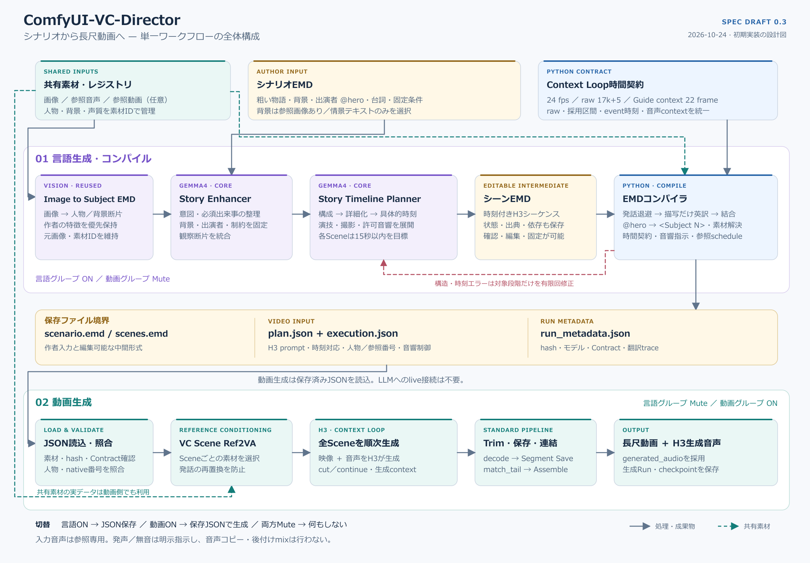

# 全体仕様

状態: Draft / 0.3



[SVG版](../assets/vc-director-overview.svg)も参照できる。図は本仕様の責務・ファイル境界・単一WFの切替を表す。

## 1. 目的

シーンより粗い日本語シナリオを、Gemma4で複数の具体的なシーンへ展開し、Context Loopによって全シーンを順次生成する。初期検証は60秒から3〜5分へ拡張する。これは検証目標であり生成上限・品質保証ではない。

## 2. 全体フロー

```text
共有素材 → Image to Subject EMD → 人物・背景の観察断片
作者のシナリオEMD + 観察断片
  → Story Enhancer（意図・固定条件・参照の整理）
  → Story Timeline Planner / Gemma4
      シーン構成 → 具体化 → 具体的時刻 → シーンEMD
  → Pythonコンパイル層
      発話退避・人物記号解決・英訳・Python結合・時間Contract・参照schedule
  → plan.json + execution.jsonを保存
  ── 同一WF内のグループを切替 ──
  → 保存済みJSONの読込・共有素材との照合
  → Context Loopで全シーンを生成
  → H3生成音声と映像をContractでtrim・連結・保存
```

## 3. 責務

| 部品 | 責務 |
|---|---|
| Image to Subject EMD | 画像の可視事実をSubject / Scene断片へ変換 |
| Story Enhancer | シナリオの意図、必須出来事、固定条件、背景・出演者を整理 |
| Story Timeline Planner | シーン構成、演出、演技、カメラ、許可音響、具体的な開始・終了時刻を生成 |
| Pythonコンパイル層 | EMD解析、発話保護・結合、人物・素材参照解決、時間Contract、音響指示、JSON出力 |
| コンパイル済み実行アダプタ | 素材・schedule・native番号を検証し、発話の再置換を防ぐ。創作や再計画はしない |
| Context Loop | Ref2VA条件付け、映像・音声生成、継続context、保存・連結 |

入力音声は参照としてだけ使い、音声生成はH3が担当する。元音源のコピー・後付けmix・音声尺での作品長決定は行わない。発声・全音響無音・物理音のみを区別して明示指示する。

## 4. シナリオで決めるもの

各展開に使用する背景と出演者を指定する。背景は参照画像付きでも、自然文だけの情景でもよい。Gemma4は指定された集合の範囲で複数シーンを構成する。人物・背景の変更は、次の展開や作者指定の変化に対応付ける。

必須出来事、順序、結末、台詞は保持する。シーン分割、つなぎの動作、未指定の撮影、許可された音響は生成できる。詳細は[シナリオEMD](simple-emd.md)と[計画コア](scene-expansion.md)に定める。

## 5. 中間形式・状態・再実行

正本はシナリオEMDとシーンEMD。typed artifactはそれぞれの解析・検証表現であり、別の物語を持たない。状態・出典・作者固定フラグもシーンEMDで保持する。

シーンIDは並び順と分離する。原シナリオ範囲、背景・出演者、開始・終了状態、先行依存を保存する。構成変更後はGemma4が時刻を再生成し、Pythonが検証する。編集後にPythonが古い時刻を黙って平行移動しない。

[単一WF](workflow.md)で言語生成グループと動画生成グループを切り替え、動画生成には保存済みJSONを使う。素材やPlanが既存Runと一致しない場合、無検証で再開しない。
